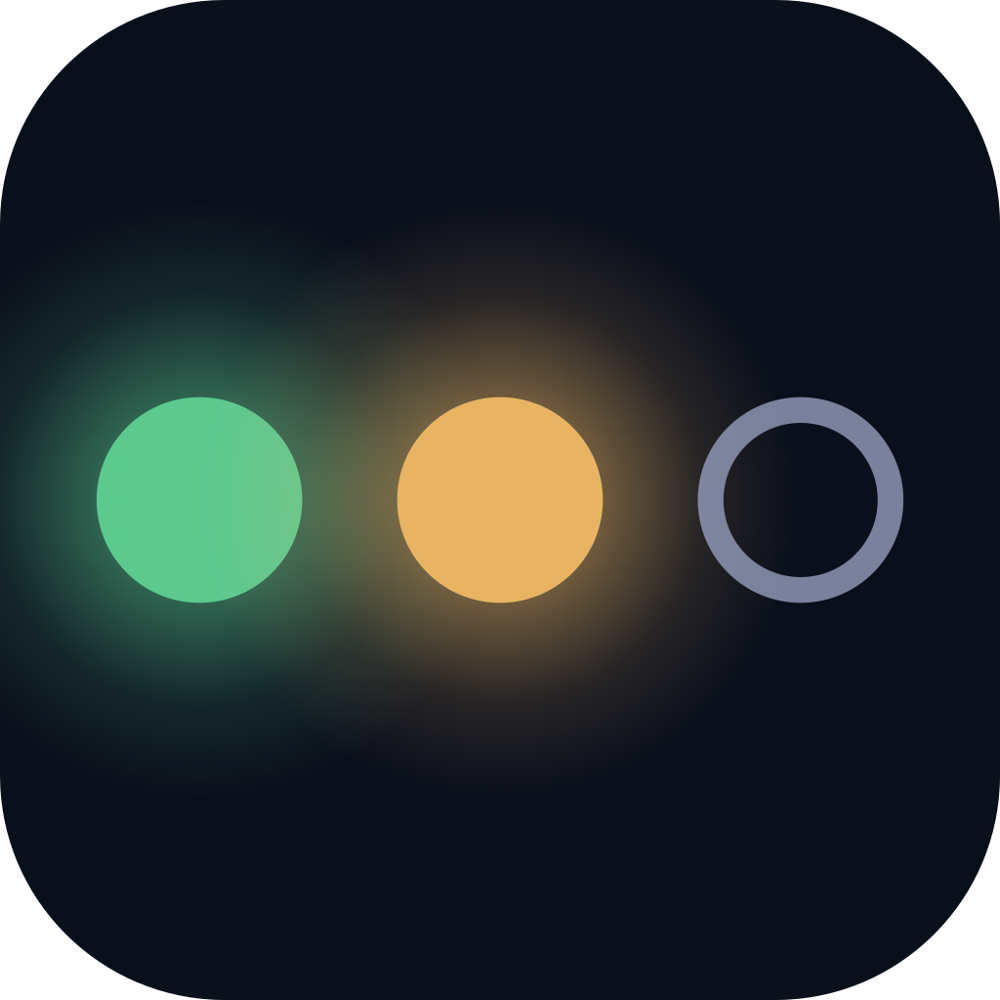

<div align="center">

<!-- agent-deck mark: status dots on Calm Navy -->


# Agent Deck

[](https://github.com/asheshgoplani/agent-deck/stargazers)
[](https://github.com/asheshgoplani/agent-deck/releases)
[](https://go.dev)
[](LICENSE)
[](https://github.com/asheshgoplani/agent-deck)
[](https://github.com/asheshgoplani/agent-deck/releases)
[](https://discord.gg/e4xSs6NBN8)

[Install](#installation) . [Quick Start](#quick-start) . [Connect your assistant](#connect-your-assistant) . [Docs](#documentation) . [Discord](https://discord.gg/e4xSs6NBN8) . [FAQ](docs/guide/faq.md)

</div>

> **kickinrad fork:** This repository packages a maintained fork of
> [asheshgoplani/agent-deck](https://github.com/asheshgoplani/agent-deck). Each release is an
> upstream release plus the fork's patches, tagged `v<upstream>-kickinrad.<n>` and published as
> a GitHub pre-release. Install it with mise (see [Installation](#installation)).
>
> **Releasing the fork:** rebase the fork's patches onto the new upstream release tag and
> merge the result into `stack`. Tag that commit `v<upstream>-kickinrad.<n>` and push the tag.
> When GitHub Actions runs on the fork, the tag push builds and publishes the release. Otherwise
> run `make release-local` on the tagged commit, check the draft's assets, and publish it as a
> pre-release with `gh release edit <tag> --draft=false --latest=false`.

Agent Deck runs all your AI coding agents (Claude Code, Codex, Gemini CLI, OpenCode and more) in one terminal and shows which ones are working, waiting, or done.

https://github.com/user-attachments/assets/e4f55917-435c-45ba-92cc-89737d0d1401

## Installation

Works on macOS, Linux and Windows (WSL).

This maintained fork is distributed through mise. Fork releases are GitHub
pre-releases, so track them with `prerelease = true`:

```toml
[tools]
"github:kickinrad/agent-deck" = { version = "latest", prerelease = true }
```

Then run: `agent-deck`. Do not use the upstream installer, Homebrew tap, or
`go install ...@latest`; each can replace the reviewed fork with upstream.

This fork is updated only through mise. Do not run `agent-deck update`,
install update timers, or use Homebrew to update it. In host configuration,
disable native automatic checks, installation, and restart so mise owns
updates:

```toml
[updates]
check_enabled = false
auto_install = false
auto_restart = false
auto_update_remotes = false
```

The fork updater targets `kickinrad/agent-deck`; these settings ensure one
reviewed version serves the CLI, web, and notifier.

Uninstall and shell completion: [Install and update](docs/guide/install.md).
Skip its install and update commands, which fetch upstream builds.

## Quick Start

```bash
cd ~/code/my-project              # any project folder
agent-deck launch . -c claude     # create and start a Claude Code session here
agent-deck                        # open the deck, pick the session, press Enter
```

The keys you need first:

| Key | Action |
|-----|--------|
| `Enter` | Attach to session |
| `Ctrl+Q` | Detach from session |
| `n` | New session |
| `/` | Search |
| `Alt+W` | Show me around: what you can do, your agents and sign-in |
| `Alt+N` | What's new: this version's highlights and your reports it fixed |
| `?` | Full help |

More commands and every key: [Quick start and keys](docs/guide/quick-start.md).

## Connect your assistant

Paste this into your assistant (Hermes, OpenClaw, Grok, Claude, ChatGPT, Codex...):

```text
Read https://raw.githubusercontent.com/asheshgoplani/agent-deck/main/docs/assistants/SETUP-PROMPT.md and follow it to connect yourself to agent-deck on my machine. Ask me before each step that changes anything.
```

It checks agent-deck, connects itself, saves its own config and tests it. Or run `agent-deck connect` and paste what it prints, or use the Connect page in `agent-deck web`.

Your assistant can only read your sessions at first (read-only). You choose if it may do more. Details: [Connect an assistant](https://github.com/asheshgoplani/agent-deck/blob/main/docs/assistants/README.md).

## Documentation

- [Guide index](docs/guide/README.md): every guide and reference in one list
- [Install and update](docs/guide/install.md)
- [Quick start and keys](docs/guide/quick-start.md)
- [Sessions, groups and config](docs/guide/sessions.md): MCP and skills managers, groups, accounts, search, status, forking, archive, feedback
- [Worktrees and sandboxes](docs/guide/worktrees.md): git worktrees, Docker sandbox
- [Conductor and watchers](docs/guide/conductor.md): run a fleet from your phone
- [Tools, costs and quotas](docs/guide/tools.md): supported agents, cost dashboard, `agent-deck usage`
- [Remote machines and the web UI](docs/guide/remote-and-web.md)
- [FAQ and asking an AI](docs/guide/faq.md)
- [CLI reference](skills/agent-deck/references/cli-reference.md) . [Config reference](skills/agent-deck/references/config-reference.md) . [Troubleshooting](skills/agent-deck/references/troubleshooting.md)
- [Contributing and development](docs/guide/contributing.md) . [CONTRIBUTING.md](CONTRIBUTING.md) . [CHANGELOG.md](CHANGELOG.md)

## Star History

If Agent Deck saves you time, give us a star! It helps others discover the project.

[](https://star-history.com/#asheshgoplani/agent-deck&Date)

## License

MIT License — see [LICENSE](LICENSE)

---

<div align="center">

Built with [Bubble Tea](https://github.com/charmbracelet/bubbletea) and [tmux](https://github.com/tmux/tmux)

**[Docs](skills/agent-deck/references/) . [Discord](https://discord.gg/e4xSs6NBN8) . [Issues](https://github.com/asheshgoplani/agent-deck/issues) . [Discussions](https://github.com/asheshgoplani/agent-deck/discussions)**

</div>
